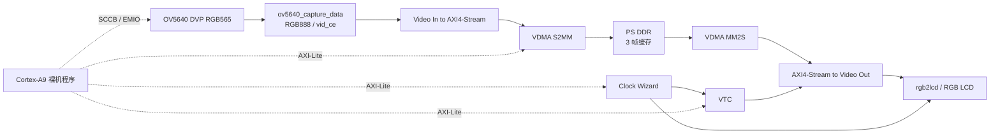

# OV5640 → DDR → RGB LCD：Zynq-7020 项目分析

这个私有仓库保存原始 Vivado/Vitis 项目、必要的自定义 IP 和中文分析，供网页端继续审查。

目标器件为 `xc7z020clg400-2`，工程版本为 Vivado/Vitis 2020.2。PS 运行 Cortex-A9 裸机程序，配置 OV5640、VDMA、像素时钟和 VTC；PL 负责摄像头采集、DDR 帧缓存和 LCD 视频输出。

## 从这里开始

1. [项目分析与问题清单](docs/PROJECT_ANALYSIS.md)
2. [可直接复制的网页端分析提示词](docs/WEB_ANALYSIS_PROMPT.md)
3. [复现与验证说明](docs/REPRODUCTION.md)
4. [文件、编码与来源清单](docs/source_manifest.json)
5. [已有实现报告](docs/evidence/)
6. [蓝色瓶盖检测、三模式画框与安全集成](docs/BLUE_TRACKER.md)

## 文件组织

| 路径 | 内容 |
| --- | --- |
| `ov5640_lcd.xpr` | Vivado 工程；自定义 IP 路径已改为仓库内相对路径 |
| `ov5640_lcd.srcs/` | Block Design、IP 配置、顶层 wrapper、引脚约束 |
| `ip_repo/` | 两个自定义 IP 原始包及 LCD 接口定义 |
| `vitis/ov5640_lcd/src/` | 原始裸机 C/H、链接脚本；保留原字节及中文编码 |
| `vitis/system_wrapper.xsa` | 原工作区硬件交接文件，供重建 Vitis 平台；未重新生成 |
| `docs/source_utf8/` | 中文源码 UTF-8 阅读副本；不是构建输入 |
| `docs/evidence/` | 原工作区历史时序、DRC、资源、参数证据 |
| `scripts/` | 打开工程辅助 Tcl 和轻量仓库自检脚本 |

本次只整理仓库和分析资料，未修改 HDL/C 功能逻辑。缓存、完整 BSP、bitstream、ELF 和大部分构建产物未纳入 Git；必要的自定义 IP 已从工程原引用位置补齐，且其 RTL 与本地生成目录的 RTL 字节一致。

现有报告通过的是当时已设置的时序约束，不能据此认定所有 LCD 模式和外部接口均已验证。本次没有重新综合、实现或上板测试。
